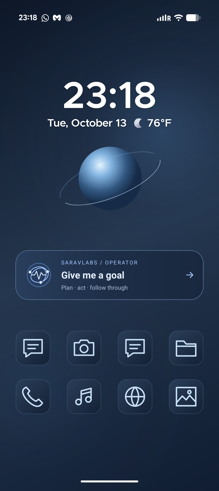

# Living Midnight

A living navy-and-blue phone theme built around the existing SaravLabs operator.

## Package

`saravlabs-living-midnight-debug.apk` is the updated assistant, including the live wallpaper and operator widget. It is a debug package, built without local model endpoint or API-key defaults. Model settings already stored by a compatible installation remain in the app's storage; this package does not supply credentials.

The APK was installed as a compatible update on the target Pixel, preserving its existing assistant storage. Updating another installation requires a matching signing certificate. If Android reports an incompatible signature, preserve the existing app and its data; do not uninstall it just to make this package install.

## Apply

1. Install the APK as a compatible update to SaravLabs.
2. Enable Android's dark appearance for Midnight. The app also has a coordinated pearl appearance when the phone uses light mode.
3. In SaravLabs, open **Settings → Living Midnight → Preview live wallpaper**. Use Android's preview and Apply controls. Choose home and/or lock screen where the phone offers those options.
4. Use **Add operator widget**, or add SaravLabs through your launcher's Widgets picker. Tapping the widget opens the real conversation. It does not send a request, start the microphone, or grant permissions.
5. In **Wallpaper & style → Colors**, pick a soft blue palette. Android controls how that palette reaches system surfaces and compatible apps.
6. Install `living-midnight-icons-debug.apk` and select **Living Midnight Icons** in Smart Launcher **Global appearance → Icon appearance → Home screen**. On **App page**, select **Use home page configuration**. The pack contains twelve original drawings and mappings for common apps; unlisted apps may retain their original icons. Individual PNGs are also available in `assets/icons/`. See `icon-pack/README.md` to rebuild it.
7. Use a dark/slate keyboard theme through the keyboard app's own settings.
8. Copy the original WAV files from `assets/sounds/` to the phone. Select them through Android's ringtone and notification settings and the Clock app's alarm sound picker. Try the alarm at your usual volume before relying on it.

The live wallpaper animates while visible, settles after 30 seconds, and wakes on touch or renewed visibility. Remove animations freezes it. The wallpaper is atmosphere, not an indicator of assistant activity. The assistant's orb reflects its actual operating states; confirmation remains amber and failures remain red.

Android system layouts and third-party app interiors remain controlled by those apps. There is no root requirement, global overlay, extra accessibility service, or autonomous background assistant added by the theme.

## Source and build

Assistant changes live in `C:/projects/saravlabs-andorid`, commit `65e4264`, rebased onto `main` commit `7654de7`. The newer learning and navigation update is preserved, and the theme styles its shared assistant presence. Approved design: `docs/design/living-midnight.md`. APK and ZIP delivery packages are kept locally; Git contains source, reproducible assets, and setup instructions.

Run `build.ps1` from this folder to rebuild the package with the repository's Gradle wrapper. Use `build.ps1 -Verify` for its full verify gate. The helper sets Java only for its process and restores the previous value afterwards.

The local build used portable Temurin 17.0.20.1+1 (official SHA-256 `e53a79c3c3d86865bd7e787903884331068e71321714ffd44f145785affc7cb0`) and the Android SDK at the repository's configured local path. The system's old JAVA_HOME was not changed globally.

See `verification.md` for the checks actually completed and device checks still required. `assets/README.md` describes the original icon and sound assets; its generator can reproduce them.

## Configured Pixel

Smart Launcher is the default home app. The live wallpaper is applied to home and lock screens, with a centered clock and slim full-width operator console below the orb. Home and app drawer use the Midnight icon pack; Messages and the Social folder received manual matching icons. The launcher's sample promotional page and Smart Search bar were removed. Android uses the first wallpaper-derived blue palette with dark mode, and Gboard uses slate gray with a blue action key. Ringtone, notification, and default alarm use the three original Midnight WAVs; existing alarm schedules were left intact.

## References

- Pixel wallpaper/color settings: https://support.google.com/pixelphone/answer/7289143?hl=en
- Wallpaper visibility lifecycle: https://developer.android.com/reference/android/service/wallpaper/WallpaperService.Engine
